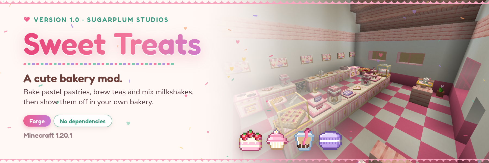

## A cute bakery mod.

**Sweet Treats** turns Minecraft into a little pastel bakery. Grow strawberries, vanilla and lavender, pick peaches and cherries from your own fruit trees, then bake, mix and decorate **24 treats and drinks**: cupcakes, macarons, cinnamon rolls, a strawberry cake you can slice, teas, milkshakes and bubble tea. Show them off on cake displays, counters, cupcake stands and glass jars, and keep track of every recipe in a **Recipe Book that fills in as you discover them**.

Three kitchen stations do the cooking: the **Bakery Oven**, the **Mixing Bowl** and the **Decoration Station**. Many treats give a small, short bonus, like Regeneration from lavender tea or Night Vision from a moon cookie.

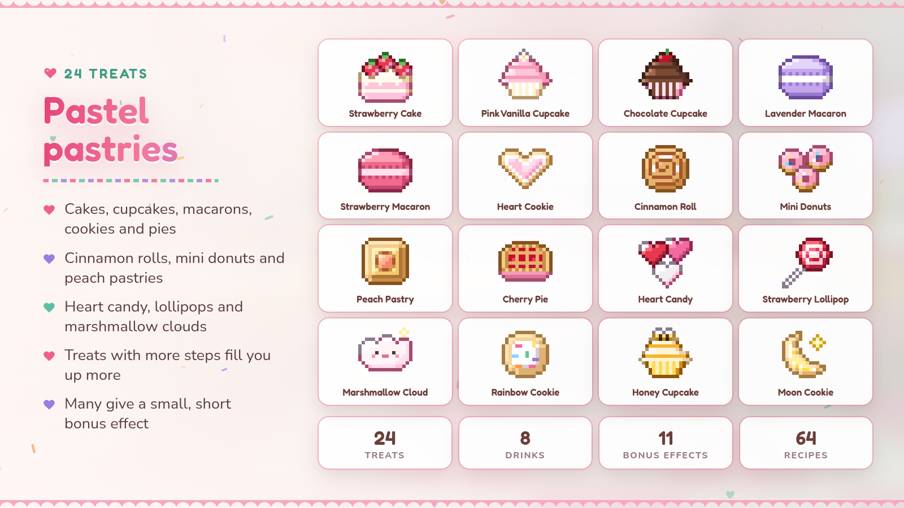

| Group | Treats |
| --- | --- |
| **Cakes & pastries** | Strawberry Cake *(placeable, 7 slices)*, Pink Vanilla Cupcake, Chocolate Cupcake, Lavender Macaron, Strawberry Macaron, Heart Cookie, Cinnamon Roll, Mini Donuts, Peach Pastry, Cherry Pie *(placeable, 4 slices)* |
| **Special treats** | Heart Candy, Strawberry Lollipop, Marshmallow Cloud, Rainbow Cookie, Honey Cupcake, Moon Cookie |
| **Drinks** | Strawberry Milk, Vanilla Milkshake, Lavender Tea, Peach Tea, Bubble Tea, Pink Lemonade, Hot Chocolate, Rose Tea |

- Treats with more steps fill you up more: a heart candy restores 1 hunger, a cupcake 5, and a cinnamon roll, peach pastry or honey cupcake 6.
- **Placeable cakes:** put a Strawberry Cake or Cherry Pie on any solid block and eat it slice by slice. A strawberry cake slice restores 3 hunger, a cherry pie slice 4. Sneak and right-click an uneaten one with an empty hand to pick it back up.

| Treat | Bonus |
| --- | --- |
| **Lavender Macaron** | Regeneration I, 5 s |
| **Heart Candy** | Regeneration I, 4 s |
| **Marshmallow Cloud** | Slow Falling I, 10 s |
| **Rainbow Cookie** | Luck I, 60 s |
| **Moon Cookie** | Night Vision I, 30 s |

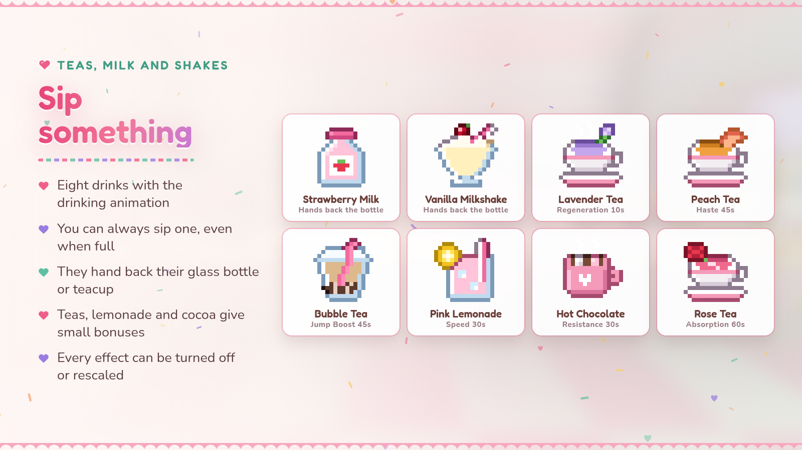

Drinks use the drinking animation, can be sipped even when you're full, and hand back their glass bottle or teacup.

| Drink | Served in | Bonus |
| --- | --- | --- |
| **Strawberry Milk** | Glass bottle | |
| **Vanilla Milkshake** | Glass bottle | |
| **Bubble Tea** | Glass bottle | Jump Boost I, 45 s |
| **Pink Lemonade** | Glass bottle | Speed I, 30 s |
| **Lavender Tea** | Teacup | Regeneration I, 10 s |
| **Peach Tea** | Teacup | Haste I, 45 s |
| **Hot Chocolate** | Teacup | Resistance I, 30 s |
| **Rose Tea** | Teacup | Absorption I, 60 s |

Bottled drinks come from the Mixing Bowl; teas and hot chocolate are brewed in the Bakery Oven in a teacup.

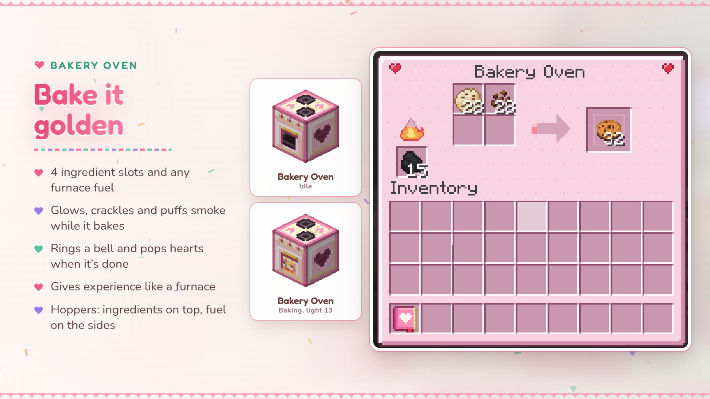

- **4 ingredient slots**, a fuel slot that takes any furnace fuel, and an output slot.
- It glows and crackles while baking and puffs smoke from its top. When a batch is done it **rings a bell and pops hearts**.
- It gives **experience** like a furnace.
- **18 recipes:** sponge cake, cupcakes, cookies, macaron shells, cinnamon rolls, donuts, pastries, cherry pie, candies, teacups, dessert plates, teas and hot chocolate, plus bread from flour and vanilla cookies from cookie dough.
- **Hoppers:** ingredients go in from the top, fuel from the sides, and the treats come out of the bottom.

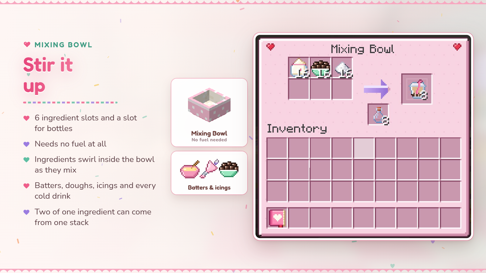

- **6 ingredient slots**, a container slot for glass bottles, and an output slot. It needs **no fuel**.
- The ingredients visibly swirl inside the bowl while they mix.
- **17 recipes:** cake batter, cookie dough, pastry dough, macaron batter, butter, chocolate, three icings, rainbow sprinkles, sugar flowers, tapioca pearls, marshmallow clouds and the four bottled drinks.
- **Hoppers:** ingredients from the top, bottles from the sides, results out of the bottom.

Machine recipes are **stack-aware**: an ingredient listed twice, like 2× Sugar, can come from a single stack, so automation is easy.

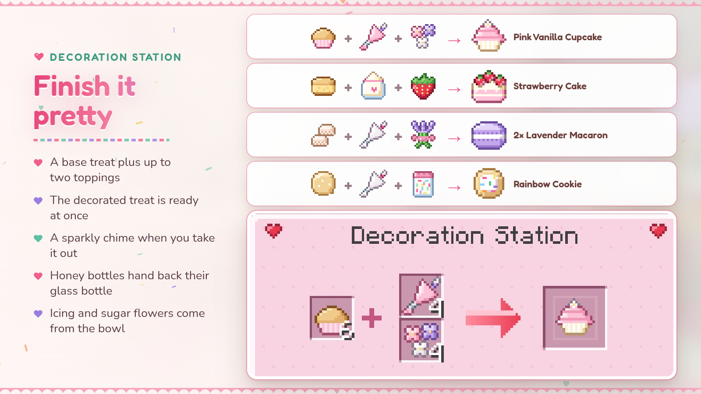

A base treat plus up to two toppings becomes a decorated treat **instantly**, with a sparkly chime. Leftover containers come back to you (a honey bottle hands back its glass bottle).

| Result | Base | Toppings |
| --- | --- | --- |
| **Strawberry Cake** | Sponge Cake | Cream, Strawberry |
| **Pink Vanilla Cupcake** | Plain Cupcake | Pink Icing, Sugar Flowers |
| **Chocolate Cupcake** | Plain Cupcake | Chocolate Frosting |
| **Honey Cupcake** | Plain Cupcake | Honey Bottle |
| **Lavender Macaron** ×2 | Macaron Shells | Icing, Lavender |
| **Strawberry Macaron** ×2 | Macaron Shells | Icing, Strawberry |
| **Heart Cookie** | Sugar Cookie | Pink Icing |
| **Rainbow Cookie** | Sugar Cookie | Icing, Rainbow Sprinkles |
| **Moon Cookie** | Sugar Cookie | Icing, Glow Berries |

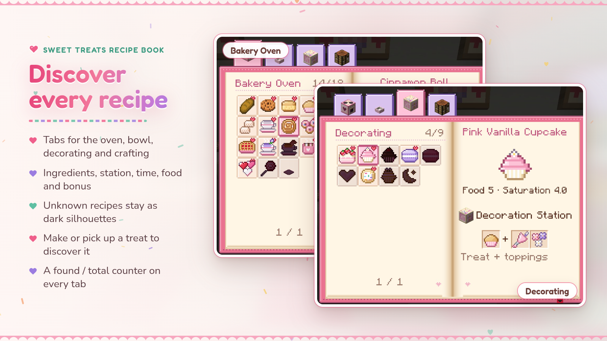

Every player gets a **Sweet Treats Recipe Book** the first time they join, and you can craft another from a book and sugar.

- **Four tabs:** Bakery Oven, Mixing Bowl, Decorating and Crafting.
- **Each recipe** shows its ingredients (alternatives cycle), its station and time, its food value and its bonus.
- **Discovery tracking:** a recipe is discovered the first time you make or pick up its result, with a chime and a "New recipe discovered" message. Undiscovered recipes show as dark silhouettes, and each tab counts how many you've found.
- Discoveries are saved with your player and **survive death**.
- The **Bakery Menu Board** block opens the recipe book too.

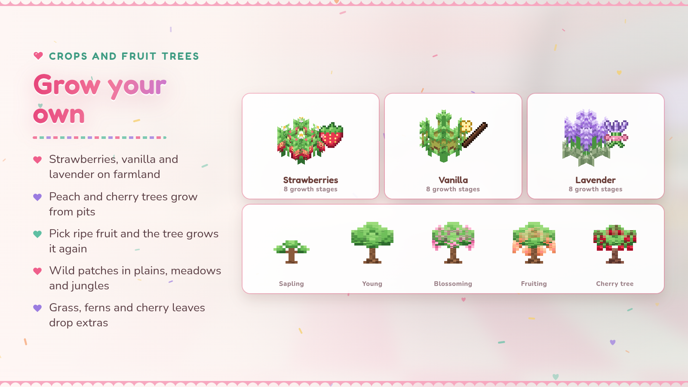

- **Crops on farmland:** Strawberries, Vanilla and Lavender, with 8 growth stages. Bone meal and Fortune work, and bees pollinate them.
- **Fruit trees:** a Peach Tree and a Cherry Tree, planted from pits. They grow from sapling to young tree to blossom to fruit. Right-click a fruiting tree to harvest it, and it grows its fruit back.
- **Wild plants** grow in the world: wild strawberries in plains, forests and meadows, wild lavender in meadows, flower forests, plains and cherry groves, and wild vanilla in jungles.
- **Extra drops:** grass, tall grass and ferns sometimes drop seeds and pits, and cherry leaves drop cherries.
- **Wandering traders** sell seeds and pits (Minecraft 1.20.1 and 1.21.1).

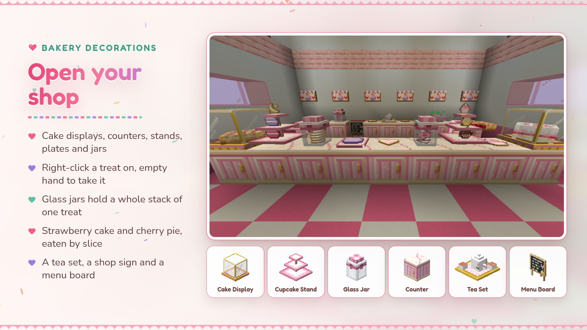

| Block | What it does |
| --- | --- |
| **Cake Display** | A glass showcase holding one treat that slowly turns. Cakes and pies show as tiny real cakes |
| **Bakery Counter** | A full-block counter that shows one treat on top |
| **Cupcake Stand** | Three porcelain tiers, one treat on each |
| **Dessert Plate** | Holds one treat |
| **Glass Jar** | Holds a whole stack of one treat, piled up inside. Sneak-click to take the whole stack |
| **Tea Set** | A tray with a teapot and cups |
| **Bakery Sign** | A shop sign for your wall |
| **Bakery Menu Board** | A chalkboard easel that opens the recipe book |

Right-click a display with a treat to put it on, and with an empty hand to take it back. **Comparators** read how full a display is. Sneak-click a counter while holding a cake to set the cake on top.

Every recipe is in the Recipe Book. The path through the kitchen:

1. **Crafting table:** flour from wheat, cream from a milk bucket, cocoa powder from cocoa beans, and the **Mixing Bowl** (a stick over planks).
2. **Mixing Bowl:** batters, doughs, icings and sugar flowers.
3. **Bakery Oven:** a furnace in terracotta over bricks.
4. **Decoration Station:** icing and sugar flowers over a crafting table and planks.

| Item | Recipe |
| --- | --- |
| Sweet Treats Recipe Book | A book and sugar |
| Cream ×3 | A milk bucket |
| Cinnamon ×4 | Any jungle log |
| Seeds and pits | One strawberry, vanilla pod, lavender, peach or cherry |
| Teacup ×2 | Clay ball and bone meal, in the oven |
| Glass Jar ×2 | A wooden slab over five glass |

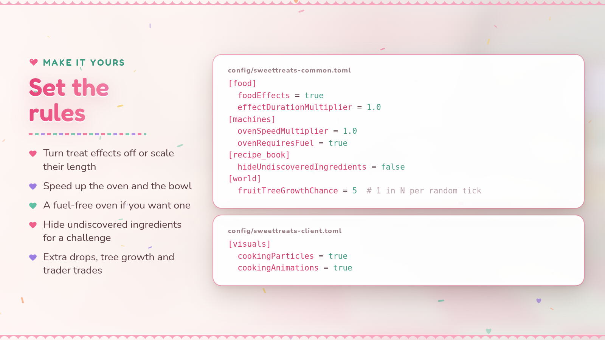

`config/sweettreats-common.toml` holds the server rules:

| Setting | Default | |
| --- | --- | --- |
| `food.foodEffects` | `true` | Treat bonuses on or off |
| `food.effectDurationMultiplier` | `1.0` | Scales every bonus duration |
| `machines.ovenSpeedMultiplier` | `1.0` | `2.0` bakes twice as fast |
| `machines.ovenRequiresFuel` | `true` | `false` for a fuel-free oven |
| `machines.mixingSpeedMultiplier` | `1.0` | Mixing Bowl speed |
| `recipe_book.giveRecipeBookOnFirstJoin` | `true` | |
| `recipe_book.discoveryMessages` | `true` | The chime and message on a discovery |
| `recipe_book.hideUndiscoveredIngredients` | `false` | Hides what goes into recipes you haven't found yet |
| `world.grassSeedDrops` | `true` | Seeds and pits from grass and ferns |
| `world.cherryLeafDrops` | `true` | Cherries from cherry leaves |
| `world.dropChanceMultiplier` | `1.0` | Scales those drop chances |
| `world.fruitTreeGrowthChance` | `5` | Fruit trees grow a stage with a 1-in-N chance per random tick |
| `world.wanderingTraderTrades` | `true` | Minecraft 1.20.1 and 1.21.1 only |

`config/sweettreats-client.toml` turns the cooking particles and the cooking animations on or off for each player.

- **One creative tab:** *Sweet Treats*.
- **Item tags** for data packs: `sweettreats:treats`, `sweettreats:drinks` and `sweettreats:displayable` (extra items the displays accept).
- **World generation** uses normal biome modifiers on Forge and NeoForge (`data/sweettreats/forge/biome_modifier` and `data/sweettreats/neoforge/biome_modifier`), so a data pack can turn the wild plants off or move them.
- **Multiplayer-ready:** recipe discoveries are saved on the server with each player.

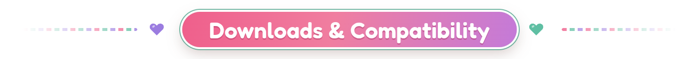

| Minecraft | Loader | Java | Also install |
| --- | --- | --- | --- |
| 1.20.1 | Forge 47 or newer | 17+ | Nothing |
| 1.20.1 | Fabric | 17+ | Fabric API |
| 1.21.1 | NeoForge | 21+ | Nothing |
| 1.21.1 | Fabric | 21+ | Fabric API |
| 26.2 | NeoForge | 25+ | Nothing |
| 26.2 | Fabric | 25+ | Fabric API |
| 26.3 | NeoForge | 25+ | Nothing |
| 26.3 | Fabric | 25+ | Fabric API |

- Install Sweet Treats on **both the server and every client**.
- Sweet Treats is a mod. It does not work as a Paper, Spigot or Folia plugin.

**Does it need any other mods?**
On Forge and NeoForge, no. On Fabric it needs only Fabric API.

**Can I automate the kitchen?**
Yes. Hoppers fill the oven and the bowl from the top, fuel the oven and give the bowl its bottles from the sides, and empty both from the bottom. Recipes take repeated ingredients from a single stack.

**Can I turn the bonus effects off?**
Yes. Set `food.foodEffects` to `false`, or shorten them with `food.effectDurationMultiplier`.

**Where do I find strawberries, vanilla and lavender?**
Wild plants grow in plains, forests, meadows, flower forests, cherry groves and jungles. Grass and ferns sometimes drop seeds, and on Minecraft 1.20.1 and 1.21.1 wandering traders sell them.

**I lost my Recipe Book.**
Craft a new one from a book and sugar. Your discoveries are saved with your player, not in the book.

**Is there a Fabric or NeoForge version?**
Yes. Sweet Treats runs on Fabric and Forge for Minecraft 1.20.1, and on Fabric and NeoForge for Minecraft 1.21.1, 26.2 and 26.3. Pick the file that matches both your Minecraft version and your loader.

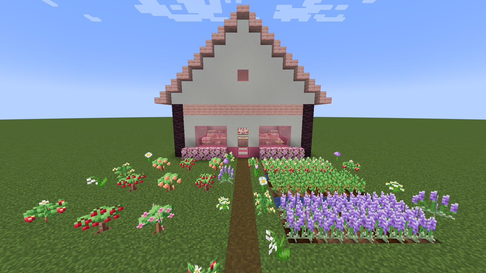

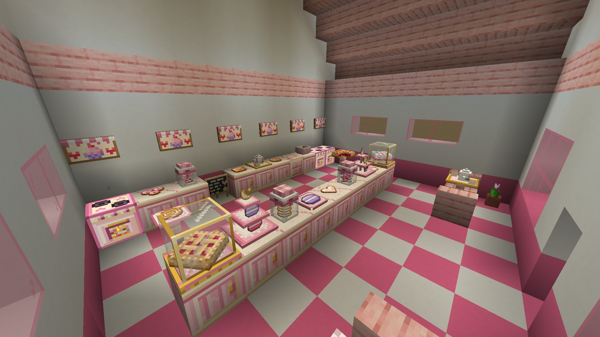

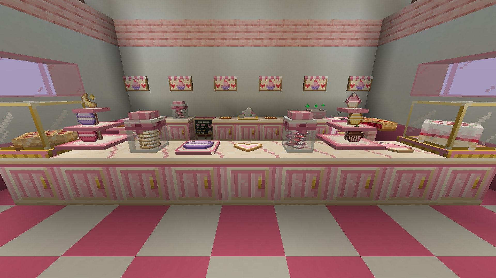

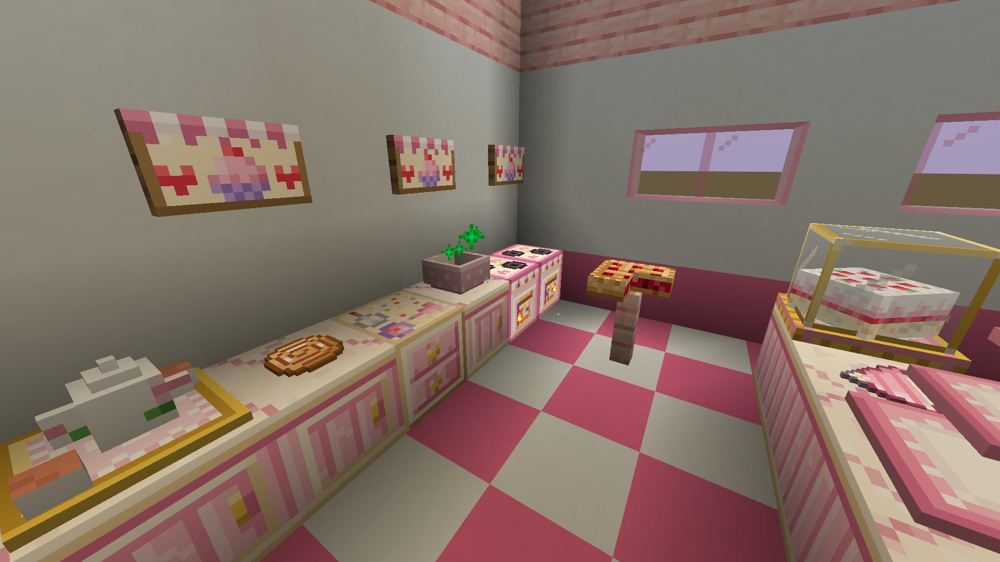

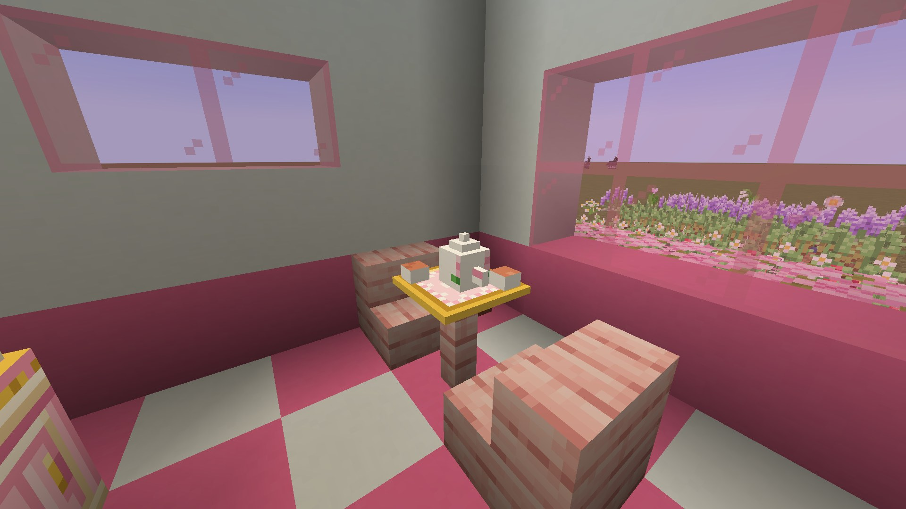

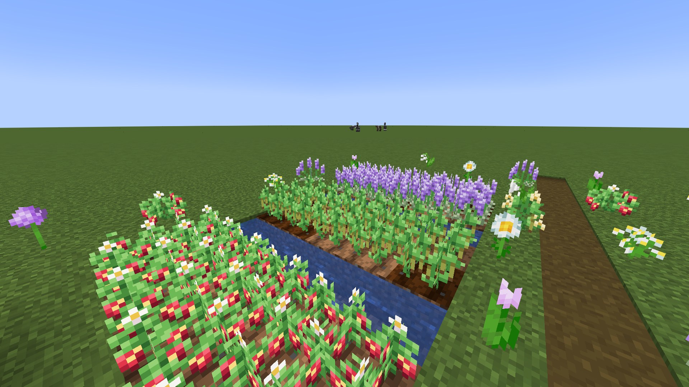

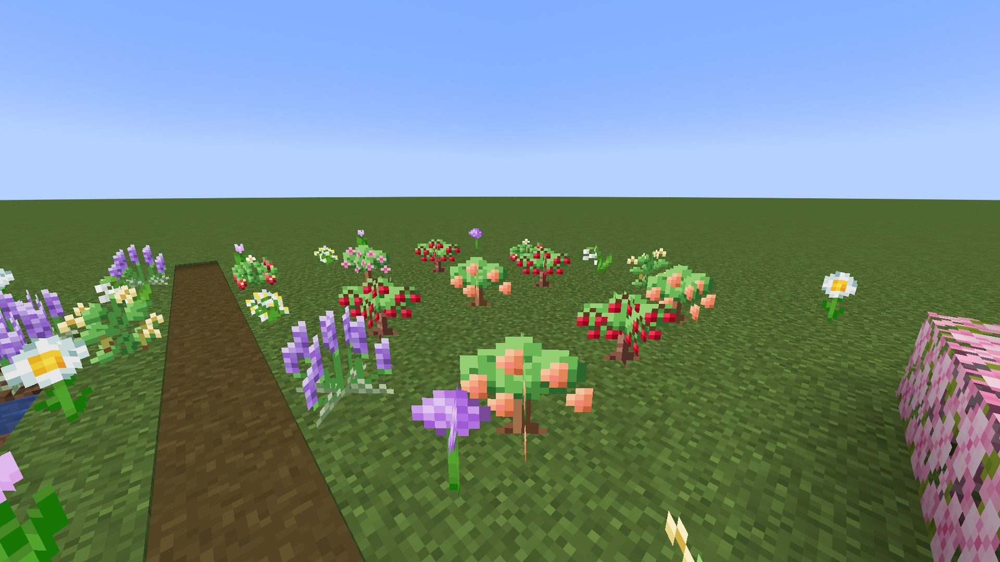

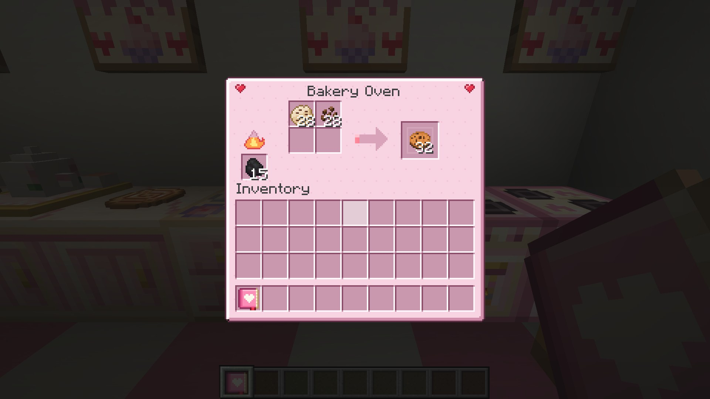

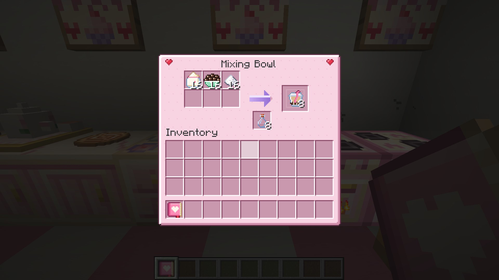

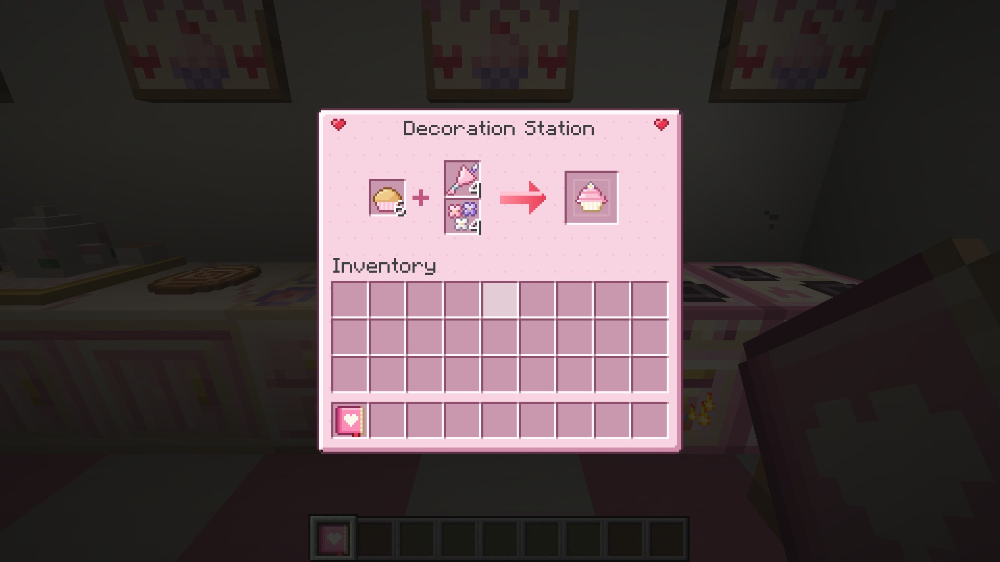

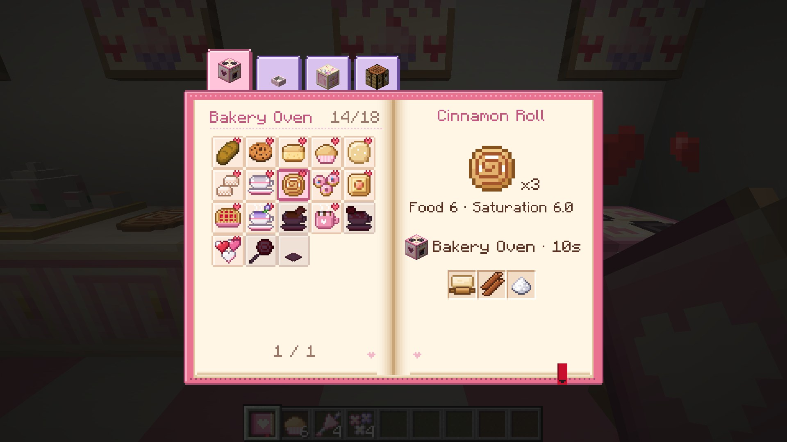

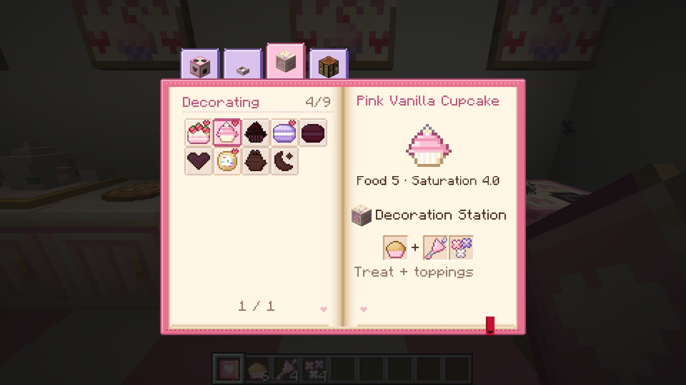

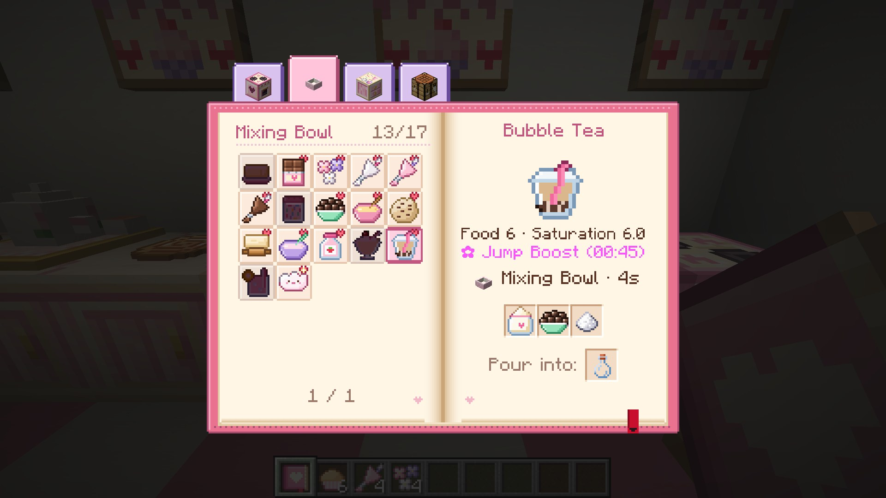

---
